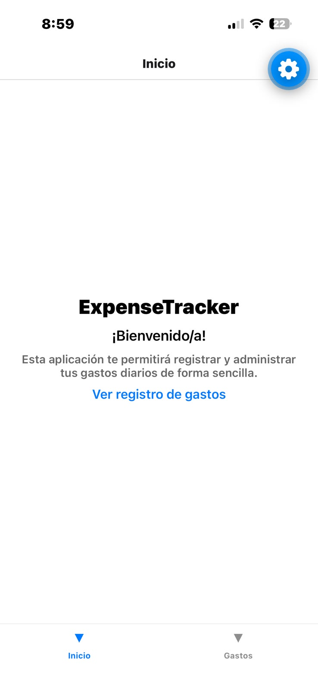
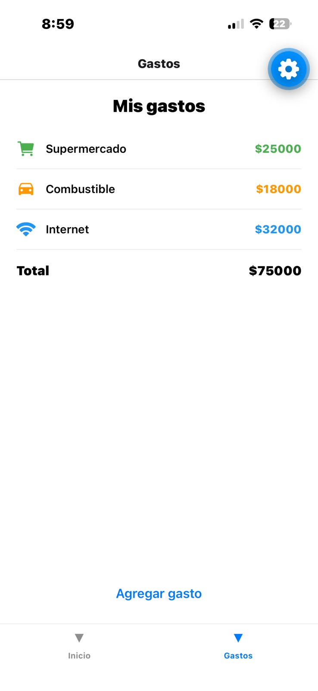
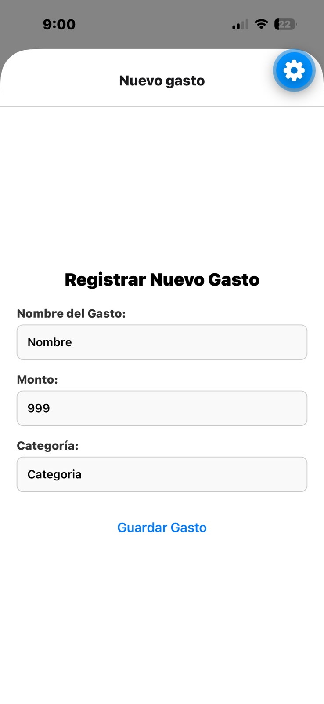
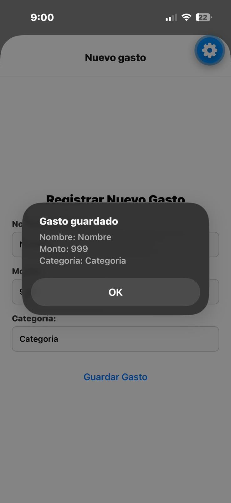

# ExpenseTracker — Sprint 1

Prototipo inicial navegable de **ExpenseTracker** desarrollado con **Expo (React Native)** y **React Navigation** para validar la interfaz y la experiencia de uso de registro y consulta de gastos personales.

## Alcance y User Stories completadas

- **Proyecto base en Expo (`#rn-s1-us1`):** Proyecto inicializado con plantilla `blank`, probado en **Expo Go** (`npx expo start`) y versionado en Git.
- **Estructura de carpetas (`#rn-s1-us2`):** Organización en `src/` separando pantallas (`HomeScreen`, `ExpensesScreen`, `ExpenseDetailScreen`, `SettingsScreen`, `NewExpenseModal`), navegación (`TabNavigator`, `StackNavigator`), componentes y assets.
- **Pantalla de bienvenida (`#main-s1-us3`):** Vista inicial de **Inicio** con el nombre *ExpenseTracker*, mensaje de bienvenida, descripción breve y acceso directo al registro de gastos.
- **Formulario de carga de gastos (`#main-s1-us4`):** Pantalla/modal **Nuevo gasto** con campos de nombre, monto y categoría, y botón *Guardar Gasto* que responde a `onPress` mostrando un aviso (`Alert`) con los datos ingresados (sin persistencia definitiva en esta etapa).
- **Listado de gastos (`#main-s1-us5`):** Pantalla **Gastos** (*Mis gastos*) con datos de ejemplo (*Supermercado* $25000, *Combustible* $18000, *Internet* $32000), íconos por rubro, total acumulado ($75000) y acceso a *Agregar gasto*.
- **Integración y navegación (`#rn-s1-us6`):** Integración de las vistas mediante navegación con tabs (*Inicio* / *Gastos*) y stack/modal para el alta de gastos y acceso a ajustes.

## Vistas del prototipo

- **Inicio:** `Inicio` con presentación de *ExpenseTracker*, botón *Ver registro de gastos* y barra inferior de pestañas.

- **Listado de gastos:** `Gastos` con el listado inicial de gastos, montos y total acumulado.

- **Nuevo gasto:** Formulario para ingresar nombre, monto y categoría con confirmación al guardar.

