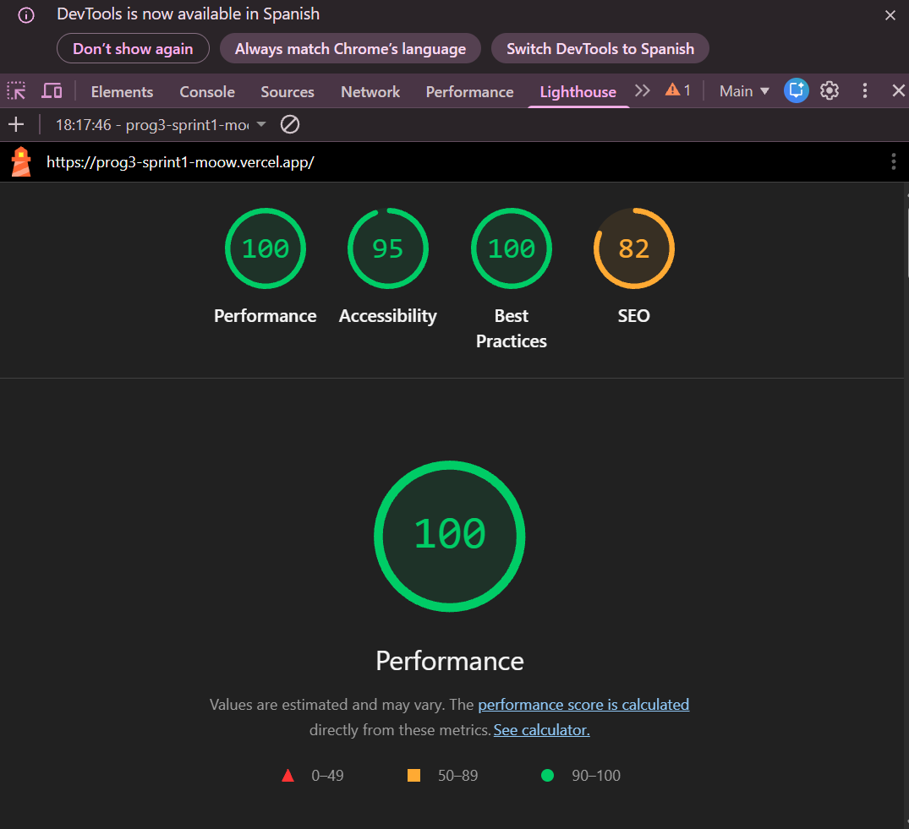

# ExpenseTracker — Sprint 2 (PWA)

Versión web instalable (**Progressive Web App**) de **ExpenseTracker**, desarrollada con **React + Vite** y **React Router** para replicar las mismas pantallas, datos y navegación del prototipo móvil del Sprint 1 y comparar ambos enfoques.

## URL Pública (HTTPS)

- **Aplicación desplegada:** [https://prog3-sprint1-moow.vercel.app/](https://prog3-sprint1-moow.vercel.app/)

## Alcance y User Stories completadas

- **Proyecto base React + Vite (`#pwa-s2-us1`):** Creación del proyecto `expense-tracker-pwa` con plantilla `react`, instalación de `react-router-dom` y control de versiones en Git.
- **Estructura y mapa de migración (`#pwa-s2-us2`):** Organización equivalente al Sprint 1 separando `pages/`, `components/`, `router/`, `layouts/`, `hooks/`, `data/` (`mockExpenses.js`) y `styles/`.
- **Identidad e instalabilidad (`#pwa-s2-us3`):** Configuración de `public/manifest.json` (`display: "standalone"`), íconos (`192x192`, `512x512` y `maskable`), meta tags móviles/iOS (`viewport-fit=cover`), hook `usePWAInstall` y banner `InstallBanner`.
- **Pantalla de bienvenida (`#main-s2-us4`):** Migración de `HomeScreen` con HTML semántico (`header`, `main`, `section`), resumen de *Total registrado* ($75.000) y *Movimientos* (3), y accesos rápidos (*Registrar Nuevo Gasto* y *Ver Listado Completo*) con `100dvh` y áreas seguras.
- **Formulario modal de carga (`#main-s2-us5`):** Implementación de `NewExpenseModal` como *bottom sheet* con `<dialog>`, `showModal()` y `createPortal`, teclado numérico (`inputmode="decimal"`), selección de categoría mediante chips (*Comida*, *Transporte*, *Servicios*) y botones *Cancelar* y *Guardar*.
- **Listado y detalle por URL (`#main-s2-us6`):** Migración de `ExpensesScreen` y `ExpenseDetailScreen` con `ExpenseCard`, badges e íconos por categoría, rutas dinámicas `/expenses/:id` mediante `useParams()` (mostrando monto, categoría, fecha y notas) y navegación hacia atrás con `navigate(-1)`.
- **Navegación app-like (`#pwa-s2-us7`):** Integración mediante `AppRouter` y `MainLayout` con barra de navegación inferior fija (`NavLink` para *Inicio*, *Gastos* y *Ajustes*) respetando `env(safe-area-inset-bottom)`.
- **Service Worker, offline y publicación (`#pwa-s2-us8`):** Configuración de `vite-plugin-pwa` para caché de recursos estáticos, prueba sin conexión, soporte de rutas SPA en producción y publicación por HTTPS en Vercel.

## Comparativa visual: Expo Go (Sprint 1) vs. PWA (Sprint 2)

| Vista | React Native / Expo Go (Sprint 1) | PWA en Teléfono (Sprint 2) |
| :--- | :---: | :---: |
| **Inicio** |  |  |
| **Listado de gastos** |  |  |
| **Nuevo gasto** |  |  |
| **Detalle de gasto** | — |  |
| **Ajustes** | — |  |

## Diferencias encontradas entre React Native (Expo) y PWA

| Aspecto | React Native (Expo — Sprint 1) | Progressive Web App (React + Vite — Sprint 2) |
| :--- | :--- | :--- |
| **Acceso y publicación** | Se prueba en Expo Go o mediante compilación nativa; no corre desde una URL web. | Publicada por HTTPS en `https://prog3-sprint1-moow.vercel.app/`, accesible desde el navegador e instalable sin tiendas. |
| **Pantalla de inicio** | Presenta bienvenida, descripción breve y acceso al registro de gastos. | Suma tarjeta de resumen (*Total registrado* $75.000 y *Movimientos* 3) y dos botones de acción rápida (*Registrar Nuevo Gasto* y *Ver Listado Completo*). |
| **Formulario de alta** | Pantalla/modal con campos de carga y aviso (`Alert`) al guardar. | *Bottom sheet* con `<dialog>` / `createPortal`, teclado virtual, chips de categoría (*Comida*, *Transporte*, *Servicios*) y acciones *Cancelar* / *Guardar*. |
| **Listado, detalle y navegación** | Listado con montos e íconos, y navegación por pilas/pestañas en memoria. | Tarjetas con badges e íconos de categoría, vista de detalle por URL (`/expenses/:id` con fecha y notas), pestaña *Ajustes* y barra inferior con íconos y áreas seguras. |
| **Modo offline y entorno** | Ejecución nativa en el dispositivo. | Requiere Service Worker (`vite-plugin-pwa`) y caché en build de producción, además de ajustes web/móvil. |
## Lighthouse

